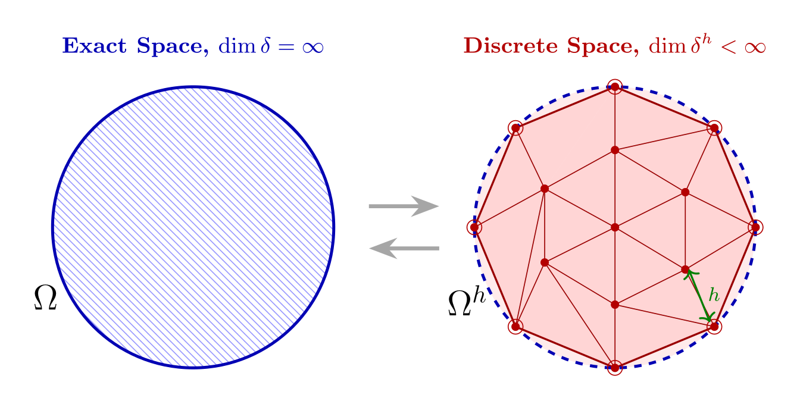
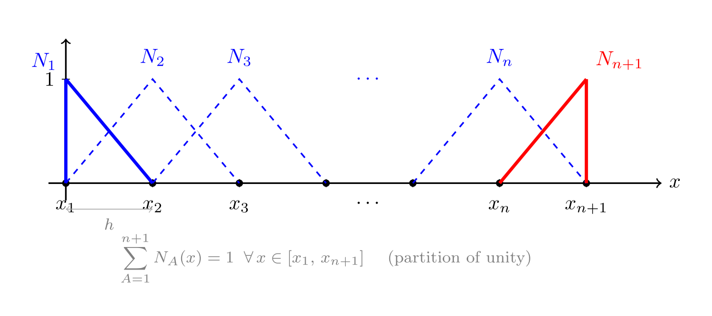
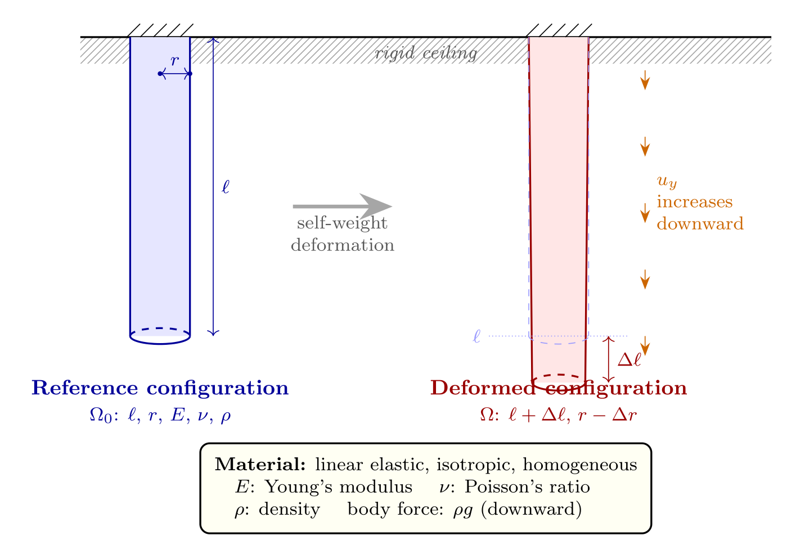

#+TITLE:  [[https://youtu.be/WwgrAH-IMOk][Central Ideas]]
#+AUTHOR: Fethi Okyar
#+DATE: 2026 Fall
#+SUBTITLE: Finite Element Method, ME 477
#+DESCRIPTION: Mathematical Language used in Continuum Mechanics and thus in modern Finite Element Method
#+STARTUP: overview
#+REVEAL_THEME: simple
#+REVEAL_INIT_OPTIONS: slideNumber:"c/t", width:1920, height:1080
#+REVEAL_TITLE_SLIDE: <h2>%t</h2> <h3>%s</h3> <h4>%d</h4>
#+OPTIONS: timestamp:nil toc:1 num:nil
#+REVEAL_EXTRA_CSS: ../style.css
#+REVEAL_ROOT: https://cdn.jsdelivr.net/npm/reveal.js
#+HTML_HEAD_EXTRA: 

* Spatial Discretization Concepts
[[./1.fundamentals.html][$\leftarrow$ Previous Lecture]]

#+ATTR_REVEAL: :frag (appear)
- We construct finite-dimensional approximations of function spaces $\delta$ and $\mathscr{V}$, denoted as $\delta^h$ and $\mathscr{V}^h$, respectively.
- The superscript refers to the association of $\delta^h$ and $\mathscr{V}^h$ with a *mesh*, or *discretization*, of the domain $\Omega$, parameterized by a characteristic length scale $h$.
  #+ATTR_HTML: :width 1000px :style "display: block; margin: auto"
  
- We think of $\delta^h$ and $\mathscr{V}^h$ as being subsets of $\delta$ and $\mathscr{V}$, written as
  \[ \delta^h \subset \delta \hspace{1em} (\mathrm{i.e., if} \; u^h \in \delta^h,\, \mathrm{then}\, u^h \in \delta) \]

  #+REVEAL: split
  Remember Tom Hughes... https://www.asme.org/topics-resources/content/thomas-jr-hughes-2018-medal

  The finite element method : linear static and dynamic finite element analysis / Thomas J.R. Hughes

* ($\S1.5$) (Bubnov-) Galerkin Approximation
Remember the resctriction on the trial and weight functions, $u$ and $w$, at the *essential* boundaries ($\mathscr{g}$ type):
#+ATTR_REVEAL: :frag (appear)
- The same applies to the discretized forms
  \[ u^h(1) = \mathscr{g} \hspace{.5em} (u^h \in \delta^h) \hspace{1em} \mathrm{and} \hspace{1em}   w^h(1) = 0  \hspace{.5em} (w^h \in \mathscr{V}^h) \]
- We construct the trial function $u^h \in \delta^h$ by using a weight function $v^h \in \mathscr{V}^h$  thus eliminating the need for $\delta^h$, as
  \[ u^h = v^h + \mathscr{g}^h \]
- Here $\mathscr{g}^h$ is a /given/ function satisfying the essential boundary conditions, i.e.,
  \[ \mathscr{g}^h(1) = \mathscr{g} \]
- Note that $u^h$ satisfies
  \begin{align}
  u^h(1) & = v^h(1) + \mathscr{g}^h \\
    & = 0 + \mathscr{g}
  \end{align}
    
#+REVEAL: split
Note that the /trial function/ $u^h$ from the space $\delta^h$ has been re-written as the sum of a function $v^h$ from $\mathscr{V}^h$ and a /given/ function. 
#+ATTR_REVEAL: :frag (appear)
- The bilinear shorthand of the /weak form/ (W) can now be written in terms of $w^h \in \mathscr{V}^h$ and $u^h \in \delta^h$:
  \[ a(w^h,\, u^h) = (w^h,\, \mathscr{f}) + w^h(0) \mathscr{h} \]
  This can be thought of as defining an "/approximate (weak) solution/", $u^h$.
- Substitition of $u^h = v^h + \mathscr{g}^h$ and using the distributive property of the bilinear operator, we write
  \[ a(w^h,\, v^h + \mathscr{g}^h) = (w^h,\, \mathscr{f}) + w^h(0) \mathscr{h} \]
- The (Bubnov-) Galerkin form of the problem, denoted by (G), is stated as follows:

  Given $\mathscr{f}$, $\mathscr{g}$, and $\mathscr{h}$, as before, find $u^h = v^h + \mathscr{g}^h$, where $v^h \in \mathscr{V}^h$, such that for all $w^h \in \mathscr{V}^h$
  \[ a(w^h,\, v^h) = (w^h,\, \mathscr{f}) + w^h(0) \mathscr{h} - a(w^h,\, \mathscr{g}^h) \]

* ($\S1.6$) Matrix Equations 
We will show that the (G) form will lead to a coupled system of linear algebraic equations. 
#+ATTR_REVEAL: :frag (appear)
- Let $\mathscr{V}^h$ consist of all linear combinations of "/given/" (shape) functions denoted by $N_A: \bar\Omega \to \mathbb{R}$, where $A=1,\,2,\,\ldots\,n$.
- We mean, $w^h \in \mathscr{V}^h$, can be constructed in terms of a set of coefficients $c_A, A=1,\, 2,\, \ldots, n$ such that
  \begin{align}
  w^h & = \sum_{A=1}^n c_A N_A \\
      & = c_1 N_1 + c_2 N_2 + \cdots + c_n N_n
      \end{align}
- The $N_A$'s are referred to as *shape*, *basis*, or *interpolation* functions. We require that each $N_A$ satisfies
  \[ N_A(1) = 0, \hspace{1em} A=1,\,2,\,\ldots,n \]
  which follows the condition $w^h(1) = 0$ (weight function vanishes at essential boundaries).
- The space of /weight/ functions $\mathscr{V}^n$ is said to have $n$ dimensions.

#+REVEAL: split
Now, we define members of /trial/ functions $\delta^h$ from the space $\mathscr{V}^h$. For this we need to define their difference $\mathscr{g}^h$ as a function. 
#+ATTR_REVEAL: :frag (appear)
- We introduce an additional shape function, $N_{n+1} : \bar\Omega \to \mathbb{R}$, which has the property
  \[ N_{n+1}(1) = 1 \]
- Note that $N_{n+1} \not\in \mathscr{V}^h$. Then $\mathscr{g}^h$ is given by
  \[ \mathscr{g}^h = \mathscr{g}\,N_{n+1} \]
  which yields the required condition that $\mathscr{g}^h(1) = \mathscr{g}$.
- With these definitions, a typical $u^h \in \delta^h$ may be written as
  \begin{align}
  u^h & = v^h + \mathscr{g}^h \\
      & = \sum_{A=1}^n d_A\, N_A + \mathscr{g} N_{n+1}
    \end{align}      
  where the $d_A$'s are coefficients, and $u^h(1) = \mathscr{g}$.

#+REVEAL: split
The constructed functions $u^h$ and $w^h$ can now be substituted into the bilinear (G) form.
#+ATTR_REVEAL: :frag (appear)
+ \[ a\left( \sum_{A=1}^n c_A N_A, \sum_{B=1}^n d_B N_B \right) = \left( \sum_{A=1}^n c_A N_A,\mathscr{f}\right) + \left[ \sum_{A=1}^n c_A N_A(0) \right] \mathscr{h} - a \left( \sum_{A=1}^n c_A N_A,\mathscr{g}N_{n+1} \right) \]
+ This can be written as a sum of terms with coefficients $c_A$ as
  \[ 0 = \sum_{A=1}^n c_A G_A \]
  where
  \[ G_A = \sum_{B=1}^n a(N_A,\,N_B)d_B - (N_A,\mathscr{f}) - N_A(0) \mathscr{h} + a(N_A,\,N_{n+1}) \mathscr{g} \]
+ _Key to Solution_: As the weight functions can have arbitrarily selected coeffients $c_A$, each $G_A$ *must be identically zero*. Hence we obtain the set of $n$ equations by writing $G_A=0,\;A=1,2,\ldots,n$. 

#+REVEAL: split
The Galerkin approximation equations can be written in the form
\[ \sum_{B=1}^n a(N_A,\,N_B)d_B = (N_A,\mathscr{f}) + N_A(0) \mathscr{h} - a(N_A,\,N_{n+1}) \mathscr{g}, \hspace{2em} A = 1,2,\ldots,n  \]
#+ATTR_REVEAL: :frag (appear)
+ This set of equations can be recast into _matrix form_ by defining $K_{AB}$ and $F_A$ as
  \[ K_{AB} = a(N_A,\,N_B) \hspace{3em} F_A = (N_A,\mathscr{f}) + N_A(0) \mathscr{h} - a(N_A,\,N_{n+1}) \mathscr{g} \]
+ which allows for rewriting the system of equations as
  \[ \sum_{B=1}^n K_{AB}d_B = F_A,\hspace{2.5em} A=1,2,\ldots,n \]
+ the following terminology is used for the equation $\boldsymbol{K} \boldsymbol{d} = \boldsymbol{F}$
  - $\boldsymbol{K} =$ stiffness matrix
  - $\boldsymbol{F} =$ force vector
  - $\boldsymbol{d} =$ displacement vector

** The Matrix Form (M)
Given the coefficient matrix $\boldsymbol{K}$ and vector $\boldsymbol{F}$, find $\boldsymbol{d}$ such that
\[ \boldsymbol{K} \boldsymbol{d} = \boldsymbol{F} \]
#+ATTR_REVEAL: :frag (appear)
- Once $\boldsymbol{d} = \boldsymbol{K}^{-1} \boldsymbol{F}$ is known, the solution of (G) may be obtained at any point $x \in \bar\Omega$ by
  \[ u^h(x) = \sum_{A=1}^n d_A N_A(x) + \mathscr{g} N_{n+1}(x) \]
- The quality of the approximation depends upon the order of interpolation $p=p(N_A)$ and the discretization size $\mathcal{O}(n)=\mathcal{O}(1/h)$.
- The matrix $\boldsymbol{K}$ is symmetric. This has important computational consequences.

** Interpolation: a piecewise-linear set of /hat/ functions
#+ATTR_HTML: :width 1400px :style "display: block; margin: auto"

* Example: Bar Under Gravity Load
We take a bar of constant circular cross-section, radius $r$, and length $l$, fixed to a horizontal ceiling wall from top and let to deform downwards under its weight. Assume the material behaves as a linearly elastic, isotropic and homogeneous medium, with elastic modulus $E$, and Poisson's ratio, $\nu$.

#+ATTR_HTML: :width 1100px :style "display: block; margin: auto"

** Exercise: Bar Formulation
- \[ \frac{d}{dy} (EA \frac{du}{dy}) - \rho g A = 0 \]
- subject to boundary conditions
- exact solution: $u(y) = \frac{\rho g}{E} (\frac{y^2}{2} + ly)$
- work on one-term and two-term FE solutions and compare with the exact solution.
