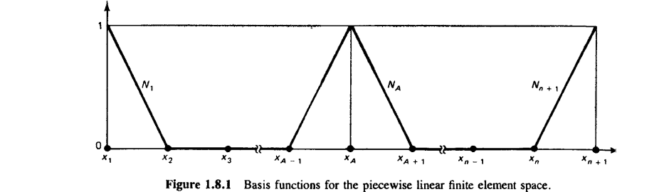
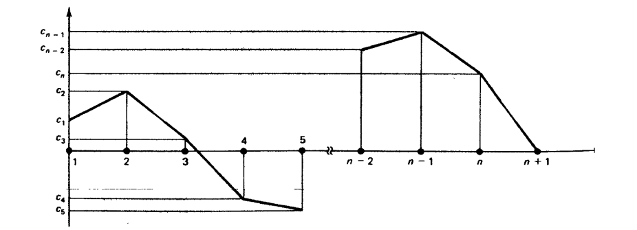
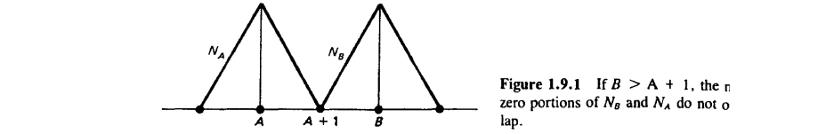
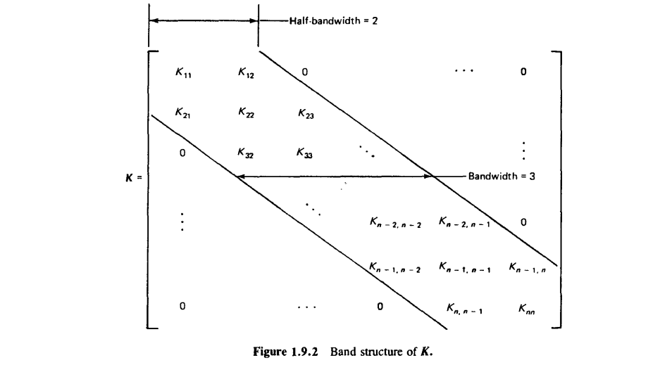

#+TITLE:  What is a Finite Element?
#+AUTHOR: Fethi Okyar
#+DATE: 2026 Fall
#+SUBTITLE: Finite Element Method, ME 477
#+DESCRIPTION: Mathematical Language used in Continuum Mechanics and thus in modern Finite Element Method
#+STARTUP: overview
#+REVEAL_THEME: simple
#+REVEAL_INIT_OPTIONS: slideNumber:"c/t", width:1920, height:1080
#+REVEAL_TITLE_SLIDE: <h2>%t</h2> <h3>%s</h3> <h4>%d</h4>
#+OPTIONS: timestamp:nil toc:1 num:nil
#+REVEAL_EXTRA_CSS: ./style.css
#+REVEAL_ROOT: https://cdn.jsdelivr.net/npm/reveal.js
#+REVEAL_PLUGINS: (notes math)
#+HTML_HEAD_EXTRA: 

* ($\S1.8$) Space of Piecewise Linear Functions
[[./2.central_idea.html][$\leftarrow$ Previous Lecture]]
#+ATTR_REVEAL: :frag (appear)
- The bar example of the preceeding section employed so-called piecewise linear functions $N_A(x)$. Spaces $\mathscr{V}^h$ and $\delta^h$ that are composed of such functions are called /piecewise linear finite element spaces/. 
- A general case in which $\mathscr{V}^h$ is $n$ dimensional, we partition the domain $[0,1]$ into $n$ nonoverlapping subintervals. The typical subinterval is denoted by $[x_A,x_{A+1}]$, where $x_A < x_{A+1}$ and $A=1,2,\ldots,n$. 
- The $x_A$'s are called */nodal points/*, or simply /nodes/. The subintervals are referred to as */elements/*.
- The mesh parameter, $h$, is taken to be the maximum element length. 
  
** Shape Functions
#+ATTR_REVEAL: :frag (appear)
- Associate to a typical internal node (i.e., $2\leq A \leq N$)
  \begin{align} N_A(x) = \begin{cases}
 \frac{(x - x_{A-1})}{h_{A-1}}, \hspace{2em} & x_{A-1} \leq x \leq x_A \\
 \frac{(x_{A+1} - x)}{h_A}, & x_A \leq x \leq x_{A+1} \\
 0, & \mathrm{elsewhere} \end{cases} \end{align}
 whereas for the boundary nodes we have $N_1(x) = \frac{x_2 - x}{h_1}$, and $N_{n+1}(x) = \frac{x-x_n}{h_n}$.

- The shape functions are also referred to as "hat", or "roof" functions.
  #+ATTR_HTML: :width 1200px :style "display: block; margin: auto"
  

#+REVEAL: split
- Note that $N_A(x_B) = \delta_{AB}$, where $\delta_{AB}$ is the Kroenecker delta (i.e, $\delta_{AB} = 1$ if $A = B$, whereas $\delta_{AB} = 0$ if $A\neq B$).
#+ATTR_REVEAL: :frag (appear)
- A typical member $w^h \in \mathscr{V}^h$ has the form $\sum_{A=1}^n c_A N_A$ and appear as below.
  #+ATTR_HTML: :width 1000px :style "display: block; margin: auto"
  
- Note that while $w^h$ is continuous, it has discontinuous slope across each element boundary, i.e. its derivative $w_{,x}^h$ will be *@@html:piecewise constant@@*.
- Typical members of $\delta^h$ are obtained by adding $\mathscr{g}^h = \mathscr{g}N_{n+1}$ to a typical member of $\mathscr{V}^h$.

* ($\S1.9$) Properties of $\boldsymbol{K}$
#+ATTR_REVEAL: :frag (appear)
- The shape functions $N_A,\, A = 1,2,\ldots,n+1$, are zero outside of the immediate neighborhood of node $A$. As a results, many of the entries of $\boldsymbol{K}$ are zero.
- Let $B > A+1$. Then
  \[ K_{AB} = \int_0^1 \underbrace{N_{A,x} N_{B,x}}_0 dx = 0 \]
- It can readily be seen that $\boldsymbol{K}$ is symmetric, i.e. $K_{AB} = K_{BA}$.
- With a matrix structure with zeros outside the /diagonal band/, $\boldsymbol{K}$ is said to be */banded/*. 
  #+ATTR_HTML: :width 1200px :style "display: block; margin: auto"
  

#+REVEAL: split
#+ATTR_HTML: :width 1200px :style "display: block; margin: auto"

#+REVEAL: split
*Definition*. An $n\times n$ matrix $\boldsymbol{A}$ is said to be */positive definite/* if
  1. $\boldsymbol{c}^T \boldsymbol{A} \boldsymbol{c} \geq 0$ for all $n$ vectors $\boldsymbol{c}$; and
  2. $\boldsymbol{c}^T \boldsymbol{A} \boldsymbol{c} = 0$ implies $\boldsymbol{c} = \boldsymbol{0}$.
@@html: @@

#+ATTR_REVEAL: :frag (appear)
- It can be shown that the stiffness matrix has the above property, i.e. the $n\times n$ matrix $\boldsymbol{K}$ is positive definite.
- A positive-definite matrix posesses a unique inverse (it can be inverted).
- The eigenvalues of a positive-definite matrix are real and positive.
- *Summary*: The stiffness matrix defined above is
  1. Symmetric
  2. Banded
  3. Positive-definite

#+BEGIN_NOTES
The practical consequence of the above properties is that a very efficient computer solution of Kd=F may be performed.
GPT: what are the standard sparse linear solvers?
#+END_NOTES

* ($\S1.12$) The Element Point of View
- Up till now the Galerkin approximation method implied the selection of a finite number of /basis/ functions without a general restriction on their region of influence.
#+ATTR_REVEAL: :frag (appear)
- Even when we restricted the /basis/ functions to have influence only up to the nearest neighboring node(s), our approach may be termed as a */global/ point of view*.
- Now, we would like to come to the _crux of the matter,_ by bringing the */local/* or */element/ point of view*. 
** What is a Finite Element?
- Two separate descriptions of the "finite element" will be provided based on the use of /global/ versus /local/ coordinates.
#+ATTR_REVEAL: :frag (appear)
- *Linear (two-noded) finite element (/global/ coordinates)*
- An individual element consists of the following quantities:
  #+ATTR_HTML: :border 0 :rules none
  | (g1) | Domain:                 | $[x_A,\,x_{A+1}]$   |
  | (g2) | Nodes:                  | $\{x_A,\,x_{A+1}\}$ |
  | (g3) | Degrees of freedom:     | $\{d_A,\,d_{A+1}\}$ |
  | (g4) | Shape functions:        | $\{N_A,\,N_{A+1}\}$ |
  | (g5) | Interpolation function: |                     |
  \[ u^h(x) = N_A(x) d_A + N_{A+1}(x) d_{A+1} \]

#+REVEAL: split
- It is fruitful to introduce a /local/ coordinate system $tau$, and a set of /local/ quantities, corresponding to the global ones, so that calculations for a typical element may be /standardized/. 
#+ATTR_REVEAL: :frag (appear)
- *Linear (two-noded) finite element (/local/ coordinates)*
- An individual element consists of the following quantities:
  #+ATTR_HTML: :border 0 :rules none
  | (l1) | Domain:                 | $[\xi_1,\,\xi_2]$   |
  | (l2) | Nodes:                  | $\{\xi_1,\,\xi_2\}$ |
  | (l3) | Degrees of freedom:     | $\{d_1,\,d_2\}$       |
  | (l4) | Shape functions:        | $\{N_1,\,N_2\}$       |
  | (l5) | Interpolation function: |                       |
  \[ u^h(\xi) = N_1(\xi) d_1 + N_2(\xi) d_2 \]
** An "affine" transformation
In relating the global and local coordinates an "affine" transformation 
