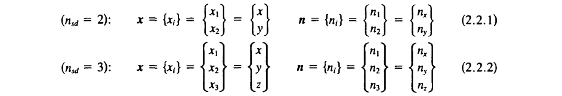
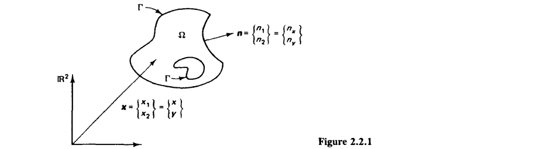
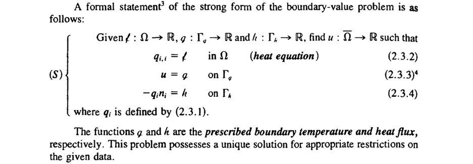

#+TITLE:  [[https://yeditepee-me477.github.io/2026-Fall/3.heat_equation.html][The Heat Equation]]
#+AUTHOR: Fethi Okyar
#+DATE: 2026 Fall
#+SUBTITLE: Finite Element Method, ME 477
#+DESCRIPTION: Mathematical Language used in Continuum Mechanics and thus in modern Finite Element Method
#+STARTUP: overview
#+REVEAL_THEME: simple
#+REVEAL_INIT_OPTIONS: slideNumber:"c/t", width:1920, height:1080
#+REVEAL_TITLE_SLIDE: <h2>%t</h2> <h3>%s</h3> <h4>%d</h4>
#+OPTIONS: timestamp:nil toc:1 num:nil
#+REVEAL_EXTRA_CSS: ./style.css
#+REVEAL_ROOT: https://cdn.jsdelivr.net/npm/reveal.js
#+REVEAL_PLUGINS: (notes math)
#+HTML_HEAD_EXTRA: 
#+REVEAL_HEAD_PREAMBLE: 

* ($\S2.1,2$) Formulation of 2/3-D BVP's 
[[./3.finite_element.html][$\leftarrow$ Previous Lecture]]
#+ATTR_REVEAL: :frag (appear)
- Let $n_{sd} (=2\,\mathrm{or}\, 3)$ denote the */number of spatial dimensions/* of the model problem and $\Omega \subset \mathbb{R}^{n_{sd}}$ be an open set with piecewise boundary $\Gamma$.
- A general point is denoted by $\boldsymbol{x}$.
- The */outward unit normal vector to/* $\Gamma$ is denoted by $\boldsymbol{n}$.
- $\boldsymbol{x}$ and $\boldsymbol{n}$ accept the following representations
  #+ATTR_HTML: :width 1200px :style "display: block; margin: auto"
  

  where the notation $\Box_i$ is known as the /index notation/.  
** An Example 2-D Domain
#+ATTR_HTML: :width 1200px :style "display: block; margin: auto"

#+ATTR_REVEAL: :frag (appear)
- We assume that $\Gamma$ admits the decomposition
  \[ \Gamma = \overline{\Gamma_g \cup \Gamma_h} \]
  where
  \[ \Gamma_g \cap \Gamma_h = \emptyset. \]
- A bar above a set means */set closure/*, i.e. the union of the set with its boundary. Thus $\bar{\Omega} = \Omega \cup \Gamma$.
** Indicial Notation 
#+ATTR_REVEAL: :frag (appear)
- Let the indices $i$, $j$, $k$, $l$, run over the values $1,\ldots,n_{sd}$.
- Differentiation is denoted by a comma (e.g., $u_{,i} = u_{,x_i} = \partial u/\partial x_i$).
- Repeated indices imply summation (e.g., in $\mathbb{R}^3$, $u_{,ii} = u_{,11} + u_{,22} + u_{,33} = \partial^2 u/\partial x^2 + \partial^2 u/\partial y^2 + \partial^2 u/\partial z^2$).
- The summation convention only applies to the indices $i$, $j$, $k$, and $l$ and only when the repetition is twice.
- If there are three, or more, repeated indices in an expression, then the summation convention is /not/ in effect.
- An index which appears only once is called a /free index/. If a free index appears in one of the terms of an expression, it has to be present in all the other terms as well.
**  Divergence Theorem (extended to 2/3-D)
Let $f:\bar\Omega \to \mathbb{R}\; \mathrm{be} \; C^1$. Then
\[ \int_\Omega f_{,i}\, d\Omega = \int_\Gamma fn_i\, d\Gamma \]
*** Integration by Parts
Let $f$ be as above and also let $g:\bar\Omega \to \mathbb{R}\; \mathrm{be} \; C^1$. Then
\[ \int_\Omega f_{,i}g\, d\Omega = -\int_\Omega fg_{,i}\, d\Omega + \int_\Gamma fgn_i\,d\Gamma \]
* Linear Heat Conduction: Strong and Weak Forms
#+ATTR_REVEAL: :frag (appear)
- Let $q_i$ denote (Cartesian components of) */heat flux vector/*, let $u$ be the */temperature/*, and let $\mathscr{f}$ be the */heat supply per unit volume/*.
- Assume the heat flux vector is defined in terms of the temperature gradient by the */generalized Fourier's law/*:
  \[ q_i = -\kappa_{ij} u_{,j}, \hspace{2em} \kappa_{ij} = \kappa_{ji} \hspace{2em} \mathrm{symmetry} \]
  where */conductivities/*, $\kappa_{ij}$'s are given functions of $\boldsymbol{x}$. (If the $\kappa_{ij}$'s are constant throughout $\Omega$, the body is said to be */homogeneous/*.)
- The generalized fouried law is a */constitutive equation/*, or */equation of state/*. 
- The */conductivity matrix/*, $\boldsymbol{\kappa} = [\kappa_{ij}]$, is assumed positive definite.
- The most common situation in practice is the */isotropic case/* in which $\kappa_{ij}(\boldsymbol{x}) = \kappa(\boldsymbol{x}) \delta_{ij}$, where $\delta_{ij}$ is the Kronecker delta.
** Strong Form
#+ATTR_HTML: :width 1200px :style "display: block; margin: auto"

