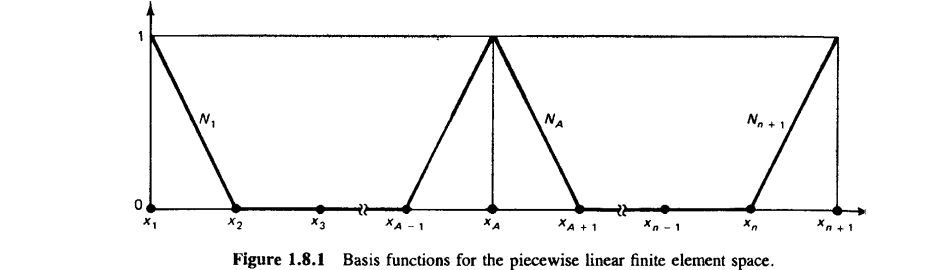
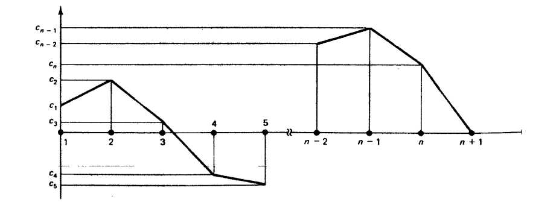

#+TITLE:  [[https://yeditepee-me477.github.io/2026-Fall/3.heat_equation.html][The Heat Equation]]
#+AUTHOR: Fethi Okyar
#+DATE: 2026 Fall
#+SUBTITLE: Finite Element Method, ME 477
#+DESCRIPTION: Mathematical Language used in Continuum Mechanics and thus in modern Finite Element Method
#+STARTUP: overview
#+REVEAL_THEME: simple
#+REVEAL_INIT_OPTIONS: slideNumber:"c/t", width:1920, height:1080
#+REVEAL_TITLE_SLIDE: <h2>%t</h2> <h3>%s</h3> <h4>%d</h4>
#+OPTIONS: timestamp:nil toc:1 num:nil
#+REVEAL_EXTRA_CSS: ./style.css
#+REVEAL_ROOT: https://cdn.jsdelivr.net/npm/reveal.js
#+REVEAL_PLUGINS: (notes math)
#+HTML_HEAD_EXTRA: 
#+REVEAL_HEAD_PREAMBLE: 

* ($\S2.1,2$) Formulation of 2/3-D BVP's 
[[./3.finite_element.html][$\leftarrow$ Previous Lecture]]
#+ATTR_REVEAL: :frag (appear)
-  
  
** 
#+ATTR_REVEAL: :frag (appear)
- 
- 
  #+ATTR_HTML: :width 1200px :style "display: block; margin: auto"
  

#+REVEAL: split
- 
#+ATTR_REVEAL: :frag (appear)
- 
  #+ATTR_HTML: :width 1000px :style "display: block; margin: auto"
  
- Note that while $w^h$ is continuous, it has discontinuous slope across each element boundary, i.e. its derivative $w_{,x}^h$ will be *@@html:piecewise constant@@*.
- 

