#+TITLE:  [[https://yeditepe-me477.github.io/2026-Fall/5.elastostatics.html][Elastostatics]]
#+AUTHOR: Fethi Okyar
#+DATE: 2026 Fall
#+SUBTITLE: Finite Element Method, ME 477
#+DESCRIPTION: Mathematical Language used in Continuum Mechanics and thus in modern Finite Element Method
#+STARTUP: overview
#+REVEAL_THEME: simple
#+REVEAL_INIT_OPTIONS: slideNumber:"c/t", width:1920, height:1080
#+REVEAL_TITLE_SLIDE: <h2>%t</h2> <h3>%s</h3> <h4>%d</h4>
#+OPTIONS: timestamp:nil toc:1 num:nil
#+REVEAL_EXTRA_CSS: ./style.css
#+REVEAL_ROOT: https://cdn.jsdelivr.net/npm/reveal.js
#+REVEAL_PLUGINS: (notes math)
#+HTML_HEAD_EXTRA: 
#+REVEAL_HEAD_PREAMBLE: 

* Classical Linear Elastostatics
[[./4.heat_equation.html][$\leftarrow$ Previous Lecture]]
#+ATTR_REVEAL: :frag (appear)
- Classical elastostatics is a rich subject in its own right.
- 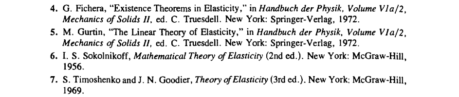
- Let $\sigma_{ij}$ denote the */stress tensor/*, let $u_i$ denote the */displacement vector/*, and let $\mathscr{f}_i$ be the */prescribed body force per unit volume/*. The */(infinitesimal) strain tensor/*, $\epsilon_{ij}$, is defined as the symmetric part of the displacement gradients, viz.,
  \[ \epsilon_{ij} = u_{(i,j)} = \frac{u_{i,j} + u_{j,i}}{2} \]
  These are also known as the */strain-displacement equations/*.

** Generalized Hooke's Law
#+ATTR_REVEAL: :frag (appear)
- The stress tensor is defined in terms of the strain tensor by the */generalized Hooke's law/*:
  \begin{align} \sigma_{ij} & = c_{ijkl} \epsilon_{kl} \\ & = c_{ijkl} u_{(k,l)} \end{align}
  where the $c_{ijkl}$'s, the */elastic coefficients/*, are point functions. If these coefficients are constant througout, the body is called */homogeneous/*. This is another */constitutive equation/*. 
- The elastic coefficients are assumed to satisfy symmetry properties which allow the interchanging indices
  #+ATTR_REVEAL: :frag (appear)
  - */major symmetry/*
    \[ c_{ijkl} = c_{klij} \]
  - */minor symmetries/*
    \[ \begin{align*} c_{ijkl} = c_{jikl} \\ c_{ijkl} = c_{ijlk} \end{align*}\]

** Upgrading from a Scalar to a Vector Solution Variable
#+ATTR_REVEAL: :frag (appear)
- The unknown solution variable is a vector, which necessitates the generalization of the boundary conditions /per vector component/:
  \[ \left. \begin{align*} \Gamma & = \overline{\Gamma_{\mathscr{g}_i} \cup \Gamma_{\mathscr{h}_i}} \\ \varnothing & = \overline{\Gamma_{\mathscr{g}_i} \cap \Gamma_{\mathscr{h}_i}} \end{align*} \right\} \hspace{2em} i=1,\ldots,n_{sd} \]
- 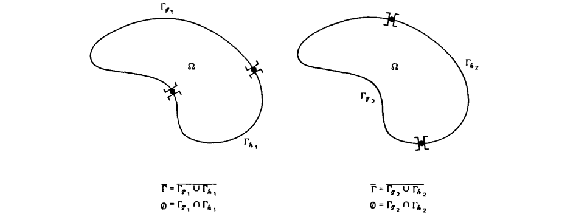

* ($\S2.7$) Strong ($S$) and Weak ($W$) Forms
** Strong Form
#+ATTR_REVEAL: :frag (appear)
- 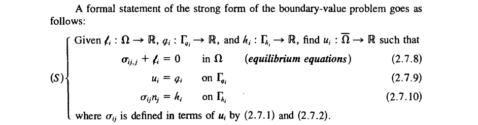
- The functions $\mathscr{g}_i$ and $\mathscr{h}_i$ are called the */prescribed boundary displacements/* and */tractions/*, respectively.
- The additional complexity is that the unknown (i.e., $\boldsymbol{u} = u_i$) is vector-valued.
** Weak Form  
#+ATTR_REVEAL: :frag (appear)
- Let $\delta_i$ denote the trial solution space and $\mathscr{V}_i$ the weight space. Each member $u_i \in \delta_i$ satisfies $u_i = \mathscr{g}_i$ on $\Gamma_{\mathscr{g}_i}$, whereas each $w_i \in \mathscr{V}_i$ satisfies $w_i=0$ on $\Gamma_{\mathscr{g}_i}$.
- The weak formulation goes:
- 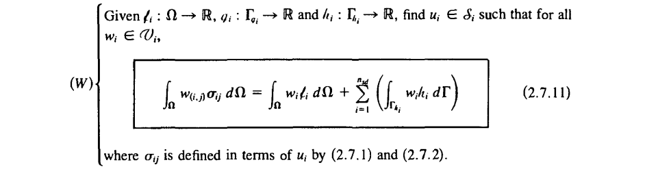
- ($W$) is also referred to as the */principle of virtual work/* or */principle of virtual displacements/*.
- Note the use of summation symbol in the last term in order to preserve the validity of the indicial expression (in the last term the index $i$ repeats three times).
*** Proof
#+ATTR_REVEAL: :frag (appear)
- *Lemma 1.* Let $s_{ij}$ be a nonsymmetric second-rank tensor. Then $s_{ij} = s_{(ij)} + s_{[ij]}$, where $s_{(ij)}$ is symmetric (i.e., $s_{(ij)} = s_{(ji)}$) and $s_{[ij]}$ is skew-symmetric (i.e., $s_{[ij]} = - s_{[ji]}$).
- *Lemma 2.* Let $s_{ij}$ be a nonsymmetric tensor and $t_{ij}$ be a symmetric tensor. Then
  \[ s_{ij} t_{ij} = s_{(ij)} t_{ij} \]
- 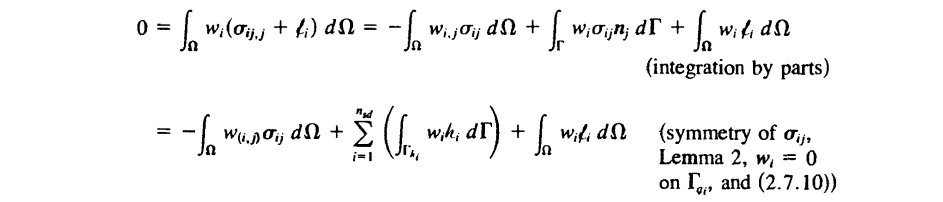
*** Abstract Notation
With the operator definitions given below

Note the replacement of $w_{(i,j)} \sigma_{ij} = w_{(i,j)} c_{ijkl} u_{(i,j)}$.  The weak form can be re-written using these operators.

#+REVEAL: split
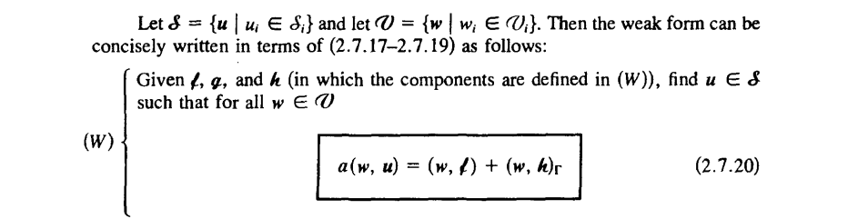
*** Reorganizing Strain Tensor Components into a Strain Vector
#+ATTR_REVEAL: :frag (appear)
- In order to increase the readability and facilitate computer implementation, the symmetric parts of the gradients of the weight and trial functions, i.e. $w_{(i,j)}$ and $u_{(i,j)}$, respectively, are recast into vector form, resulting with the definition of the so-called */strain vector operator/*, $\boldsymbol{\epsilon}$
- 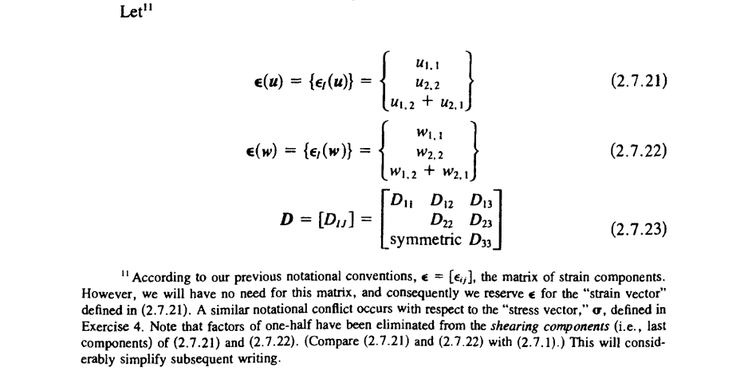
*** Reduced Elasticity Matrix Variants, $\boldsymbol{D}$
#+ATTR_REVEAL: :frag (appear)
- This reduction of order necessitates a similar reduction of the fourth order elasticity tensor, $c_{ijkl}$, to a second order tensor, $D_{IJ}$.
- $D_{IJ}$ are elasticity coefficients related to $c_{ijkl}$, associated by the relations below.

  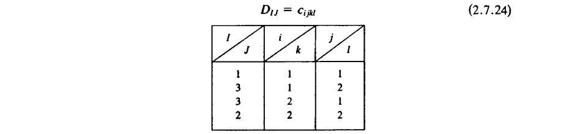
  
  The above table of conversion is valid for a */2-D plane strain/* model ($\epsilon_{33} = 0$).
- Slight modification of the coefficients will be required for other 2-D model variants.
  + 2-D Plane Stress Model, $\sigma_{33} = 0$.
  + 2-D Axisymmetric Model.
*** Dimensional Reduction of $w_{(i,j)}c_{ijkl} u_{(k,l)}$
As a result of reorganizing the components of higher order tensors into lower order tensors, 

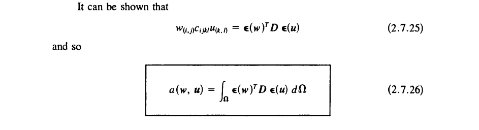
* ($\S2.8$) Galerkin Formulation
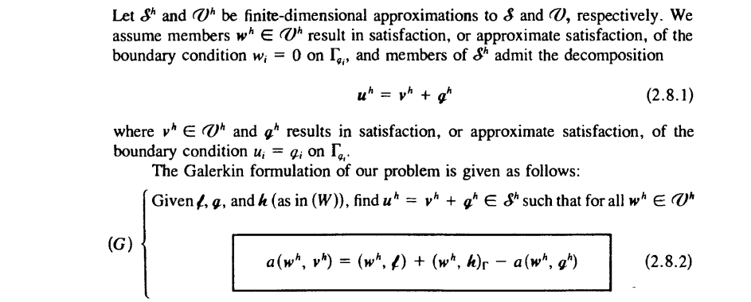
** Computer Implementation
#+ATTR_REVEAL: :frag (appear)
- To define the global stiffness and load arrays for a vector-valued problem, it is necessary to introduce the ID array.
- The variable $n_\mathrm{dof}$, is defined as the number of */degrees of freedom per node/*, is defined.
- 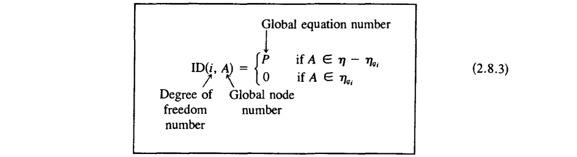
- ID has dimensions $n_\mathrm{dof} \times n_{np}$.
*** Modifying Sets and Introducing Shape Functions
#+ATTR_REVEAL: :frag (appear)
- Recall the set of global node numbers, $\eta = \{1,2,\ldots,n_{np}\}$.
- Let $\eta_{\mathscr{g}_i} \in \eta$ be the set of nodes at which $u_i^h = \mathscr{g}_i$ and let $\eta - \eta_{\mathscr{g}_i}$ be the complement of $\eta_{\mathscr{g}_i}$.
- For each node in $\eta - \eta_{\mathscr{g}_i}$, the nodal value of $u_i^h$ is to be determined.
- The explicit representations of $v_i^h$ and $\mathscr{g}_i^h$, in terms of the shape functions and nodal values are
  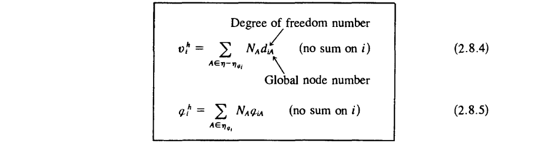
*** Basis Vectors and Tensor Notation
#+ATTR_REVEAL: :frag (appear)
- Let $\boldsymbol{e}_i$ denote the $i$th Euclidean basis vector for $\mathbb{R}^{n_{sd}}$ as

  
- The trial and weight functions can now be expressed in their tensor forms 

  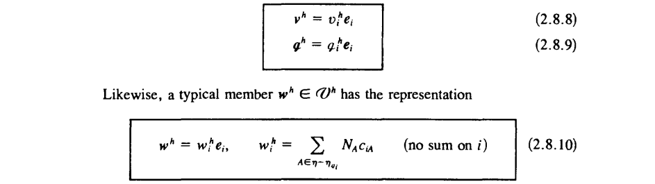
** Matrix Form (Global Scheme)
Introducing the variables in their tensor forms into the Galerkin form in it's abstract notation, we get

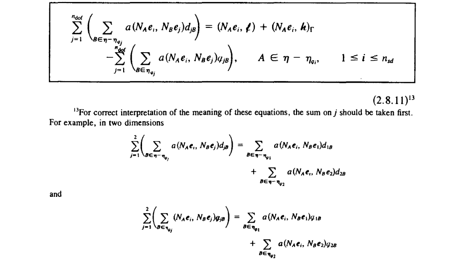

#+REVEAL: split
This is equivalent to the matrix equation

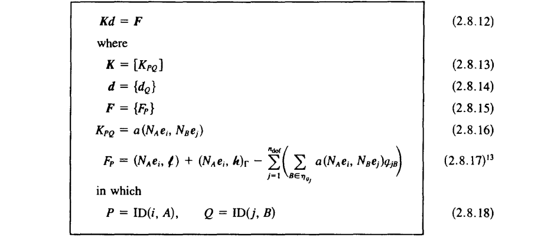
*** Introducing the Strain-Displacement Operator
#+ATTR_REVEAL: :frag (appear)
- It is customary to express the stiffness components using the strain-displacement operator, $\boldsymbol{B}$, which is defined for $n_{sd}=2$ as

  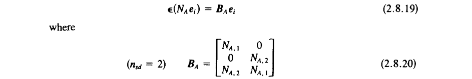
- With these, the stiffness components can be restated in their customary finite element  notation as

  
  where $P = \mathrm{ID}(i,A)$ and $Q = \mathrm{ID}(j,B)$.
* ($\S2.9$) Element Arrays (Local Scheme)
#+ATTR_REVEAL: :frag (appear)
- In defining $\boldsymbol{k}^e$ and $\boldsymbol{f}^e$, we introduce a number of additional programming parameters for convenience:
  #+ATTR_REVEAL: :frag (appear)
  + $n_{ed}$: number of element degrees of freedom per node. Note that it is possible to have $n_{ed} \leq n_\mathrm{dof}$.
  + $n_{en}$: number of nodes per element
  + $n_{ee}$: number of element equations, $n_{ee} = n_{ed} n_{en}$.
- 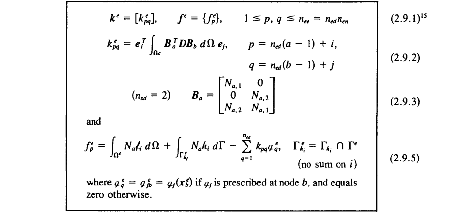
** Nodal Submatrices
#+ATTR_REVEAL: :frag (appear)
- The */nodal submatrix/* is defined for programming purposes as
  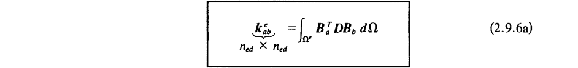
- By combining the nodal contributions into a single array
  \[ \boldsymbol{B} = [\boldsymbol{B}_1, \boldsymbol{B}_2, \ldots, \boldsymbol{B}_{n_{en}}] \]
- which enables writing the element stiffness matrix as
  \[ \boldsymbol{k}^e = \int_{\Omega^e} \boldsymbol{B}^T \boldsymbol{D} \boldsymbol{B}\, d\Omega \]
- For example, for $n_{sd} = 2$, four-noded element
  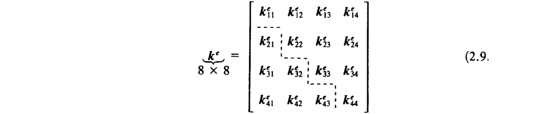
** Element Calculations
#+ATTR_REVEAL: :frag (appear)
- Let $n_{sd} = 2$.  The displacement at node $a$ in element $e$ is
  \[ \boldsymbol{d}_a^e = \begin{Bmatrix} d_{1a}^e \\ d_{2a}^e \end{Bmatrix} \]
  where $d_{ia}^e = u_i^h(x_a^e)$
- The stress at a given point $\boldsymbol{x} \in \Omega^e$ can be calculated by
  \[ \boldsymbol{\sigma}(\boldsymbol{x}) = \boldsymbol{D} \sum_{a=1}^{n_{en}} \boldsymbol{B}_a(\boldsymbol{x}) \boldsymbol{d}_a^e \]
* Examples
** 2-D Mesh
Study the essential B.C.'s in the below mesh of four-node rectangular elements below
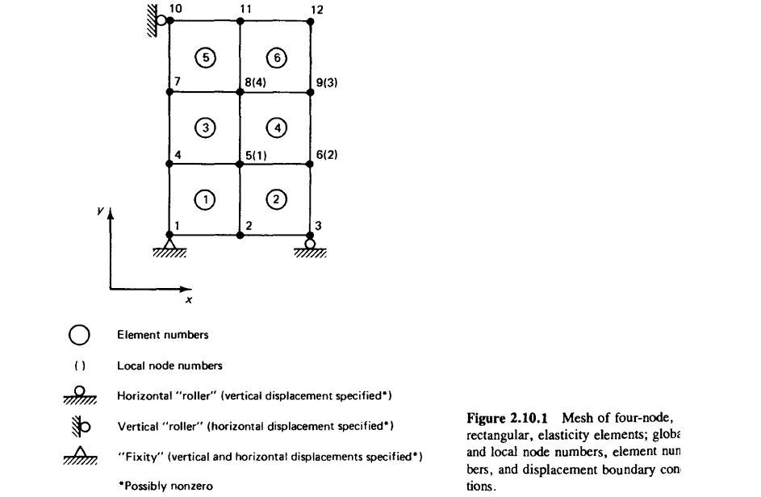

#+REVEAL: split
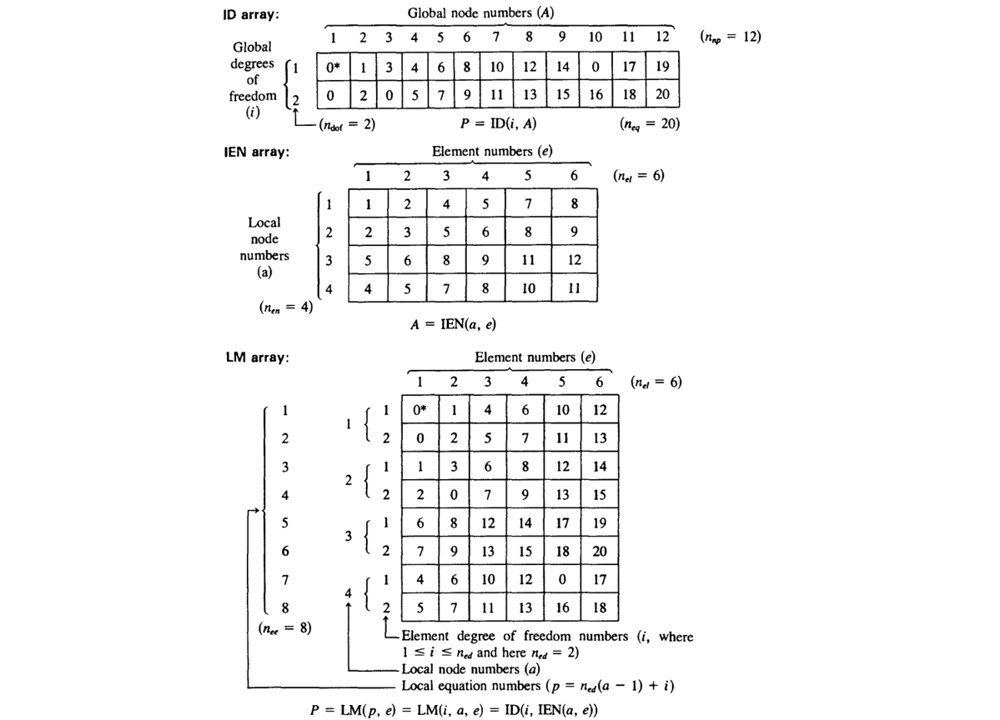
** Four-noded Element
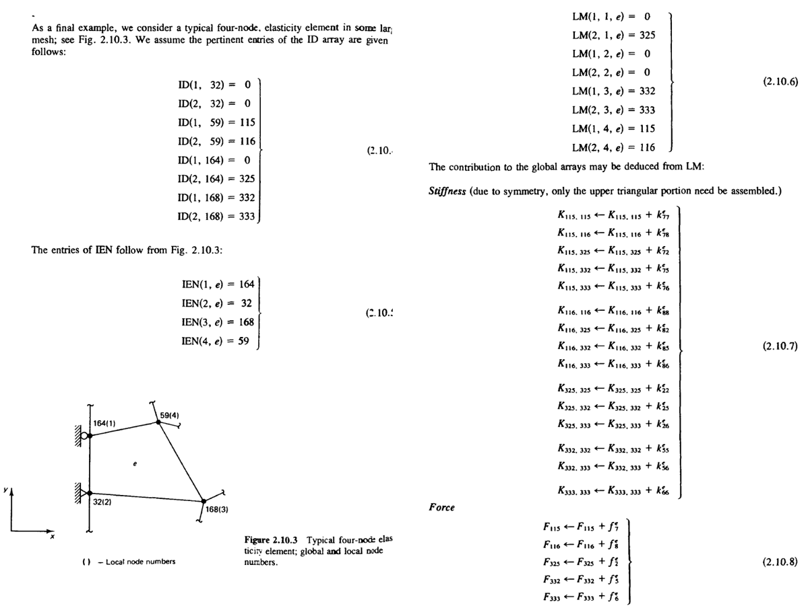

#+REVEAL: split
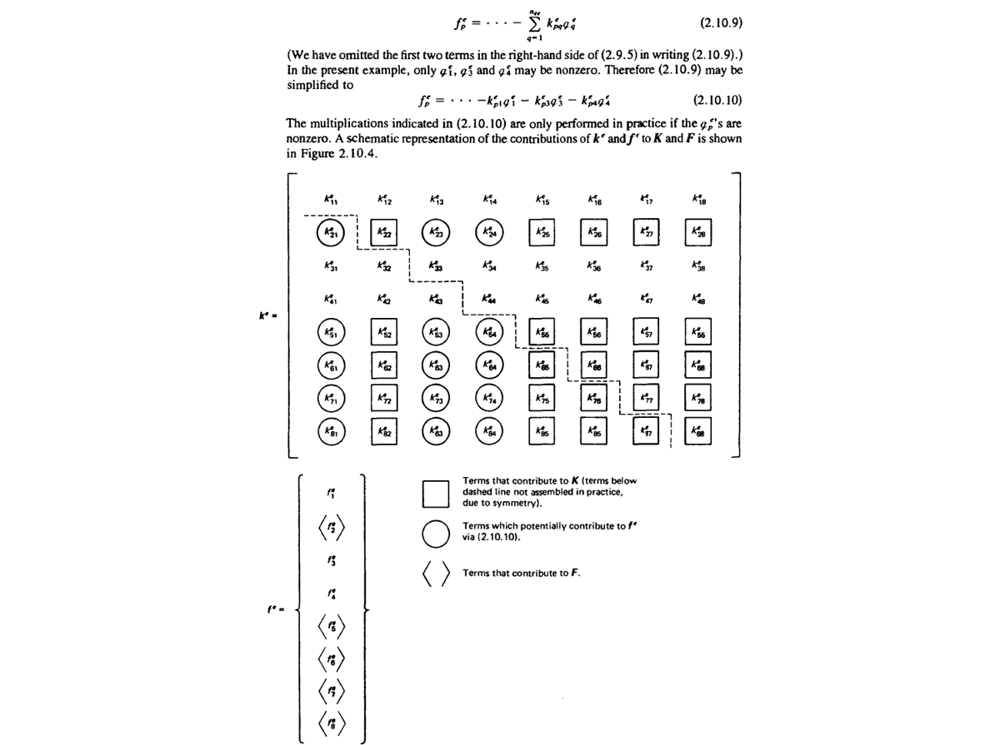
