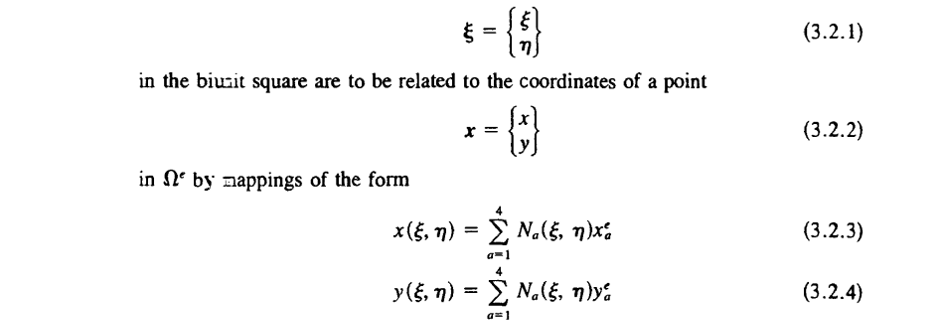

#+TITLE:  [[https://yeditepe-me477.github.io/2026-Fall/6.elementaryconcepts.html][Elementary Concepts in Finite Elements]]
#+AUTHOR: Fethi Okyar
#+DATE: 2026 Fall
#+SUBTITLE: Finite Element Method, ME 477
#+DESCRIPTION: Mathematical Language used in Continuum Mechanics and thus in modern Finite Element Method
#+STARTUP: overview
#+REVEAL_THEME: simple
#+REVEAL_INIT_OPTIONS: slideNumber:"c/t", width:1920, height:1080
#+REVEAL_TITLE_SLIDE: <h2>%t</h2> <h3>%s</h3> <h4>%d</h4>
#+OPTIONS: timestamp:nil toc:1 num:nil
#+REVEAL_EXTRA_CSS: ./style.css
#+REVEAL_ROOT: https://cdn.jsdelivr.net/npm/reveal.js
#+REVEAL_PLUGINS: (notes math)
#+HTML_HEAD_EXTRA: 
#+REVEAL_HEAD_PREAMBLE: 

* ($\S3.1$) Preliminary Concepts
[[./5.elastostatics.html][$\leftarrow$ Previous Lecture]]
** Basic convergence requirements
:PROPERTIES:
:REVEAL_BACKGROUND: ./6.fig1-c0continuity.png
:REVEAL_BACKGROUND_SIZE: contain
:REVEAL_BACKGROUND_POSITION: center
:REVEAL_BACKGROUND_OPACITY: 0.3
:END:
In designing elements, their shape functions are expected to obey the below requirements: ([[file:textbook/Ch3_p1.pdf][Chapter 3]], p.109)
#+ATTR_REVEAL: :frag (appear)
+ *R1. smoothness*: smooth (i.e., at least $C^1$) on each element interior, $\Omega^e$; 
+ *R2. continuity*: continuous across each element boundary $\Gamma^e$ (see Appendix 1.I, p.52, of [[file:textbook/Ch1_p3.pdf][Chapter 1]]); and
+ *R3. completeness*.
** Remarks on R1 and R2
:PROPERTIES:
:REVEAL_BACKGROUND: ./6.fig1-c0continuity.png
:REVEAL_BACKGROUND_SIZE: contain
:REVEAL_BACKGROUND_POSITION: center
:REVEAL_BACKGROUND_OPACITY: 0.3
:END:
#+ATTR_REVEAL: :frag (appear)
1. Conditions R1 and R2 guarantee that the first derivatives of the shape functions have, at worst, finite jumps across the element interfaces. This ensures that all integrals nevessary for computation of element arrays are /well-defined/.
2. Shape functions that satisfy R1 and R2 are of class $C^0(\bar{\Omega})$, thus the name $C^0$ elements.
3. For shape functions in elements with stiffness integrands involving derivatives of order $m$, $C^m$ continuity on $\Omega^e$ and $C^{m-1}$ continuity on $\Gamma^e$ are required. Finite elements that satisfy this property are called */conforming/*, or */compatible/*.
** Remarks on R3
:PROPERTIES:
:REVEAL_BACKGROUND: ./6.fig1-c0continuity.png
:REVEAL_BACKGROUND_SIZE: contain
:REVEAL_BACKGROUND_POSITION: center
:REVEAL_BACKGROUND_OPACITY: 0.3
:END:
#+ATTR_REVEAL: :frag (appear)
1. Completeness requires that the element interpolation function ($u^h$) is capable of exactly representing an arbitrary linear polynomial. This is especially important when higher order shape functions are utilized in the interpolation.
2. In elasticity, completeness ensures that in modeling deformation, all rigid motions and constant strain states are exactly represented.
* ($\S3.2$) Bilinear Quad Element
- The domain of a straight-edged quadrilateral element is defined by the locations of its four nodal points $\boldsymbol{x}_a^e,\, a=1,\ldots,4$ in the $\mathbb{R}^2$ plane.
- It is assumed that the nodes are labeled in ascending order and counterclockwise direction.
** Element Mapping
We seek to map the given quadrilateral into the biunit square (also known as the */parent domain/*).
[[./6.fig2-quadparent.png]]
** Change of Coordinates
The coordinates of a point

where $\xi$ and $\eta$ are sometimes called the */natural coordinates/*.

#+REVEAL: split
In tensor form this reads
\[ \boldsymbol{x}(\boldsymbol{\xi}) = \sum_{a=1}^4 N_a(\boldsymbol{\xi}) \boldsymbol{x}_a^e \]
The shape functions $N_a$ are obtained by first assuming the "bilinear expansions"

[[./6.fig4-bilinearexpansions.png]]

#+REVEAL: split
Equations (3.2.6) to (3.2.9) lead to the following matrix equations:
[[./6.fig5-bilinearfunctions.png]]
** Computing the Jacobian
* ($\S3.3$) Isoparametric Elements
* ($\S3.5$) Trilinear Hex Element
* ($\S3.6$) Lagrange Polynomials
* ($\S3.8$) Gaussian Quadrature
* ($\S3.9$) Shape Function Subroutines
* ($\S3.10$) Stiffness Coding Styles
