#+TITLE:  [[https://yeditepe-me477.github.io/2026-Fall/6.elementaryconcepts.html][Elementary Concepts in Finite Elements]]
#+AUTHOR: Fethi Okyar
#+DATE: 2026 Fall
#+SUBTITLE: Finite Element Method, ME 477
#+DESCRIPTION: Mathematical Language used in Continuum Mechanics and thus in modern Finite Element Method
#+STARTUP: overview
#+REVEAL_THEME: simple
#+REVEAL_INIT_OPTIONS: slideNumber:"c/t", width:1920, height:1080
#+REVEAL_TITLE_SLIDE: <h2>%t</h2> <h3>%s</h3> <h4>%d</h4>
#+OPTIONS: timestamp:nil toc:1 num:nil
#+REVEAL_EXTRA_CSS: ./style.css
#+REVEAL_ROOT: https://cdn.jsdelivr.net/npm/reveal.js
#+REVEAL_PLUGINS: (notes math)
#+HTML_HEAD_EXTRA: 
#+REVEAL_HEAD_PREAMBLE: 

* ($\S3.1$) Preliminary Concepts
[[./5.elastostatics.html][$\leftarrow$ Previous Lecture]]
** Basic convergence requirements
:PROPERTIES:
:REVEAL_BACKGROUND: ./6.fig1-c0continuity.png
:REVEAL_BACKGROUND_SIZE: contain
:REVEAL_BACKGROUND_POSITION: center
:REVEAL_BACKGROUND_OPACITY: 0.3
:END:
In designing elements, their shape functions are expected to obey the below requirements: ([[file:textbook/Ch3_p1.pdf][Chapter 3]], p.109)
#+ATTR_REVEAL: :frag (appear)
+ *R1. smoothness*: smooth (i.e., at least $C^1$) on each element interior, $\Omega^e$; 
+ *R2. continuity*: continuous across each element boundary $\Gamma^e$ (see Appendix 1.I, p.52, of [[file:textbook/Ch1_p3.pdf][Chapter 1]]); and
+ *R3. completeness*.
** Remarks on R1 and R2
#+ATTR_REVEAL: :frag (appear)
1. Conditions R1 and R2 guarantee that the first derivatives of the shape functions have, at worst, finite jumps across the element interfaces. This ensures that all integrals nevessary for computation of element arrays are /well-defined/.
2. Shape functions that satisfy R1 and R2 are of class $C^0(\bar{\Omega})$, thus the name $C^0$ elements.
3. For shape functions in elements with stiffness integrands involving derivatives of order $m$, $C^m$ continuity on $\Omega^e$ and $C^{m-1}$ continuity on $\Gamma^e$ are required. Finite elements that satisfy this property are called */conforming/*, or */compatible/*.
** Remarks on R3
#+ATTR_REVEAL: :frag (appear)
1. Completeness requires that the element interpolation function ($u^h$) is capable of exactly representing an arbitrary linear polynomial. This is especially important when higher order shape functions are utilized in the interpolation.
2. In elasticity, completeness ensures that in modeling deformation, all rigid motions and constant strain states are exactly represented.
* ($\S3.2$) Bilinear Quad Element
- The domain of a straight-edged quadrilateral element is defined by the locations of its four nodal points $\boldsymbol{x}_a^e,\, a=1,\ldots,4$ in the $\mathbb{R}^2$ plane.
- It is assumed that the nodes are labeled in ascending order and counterclockwise direction.
** Element Mapping
We seek to map the given quadrilateral into the biunit square (also known as the */parent domain/*).
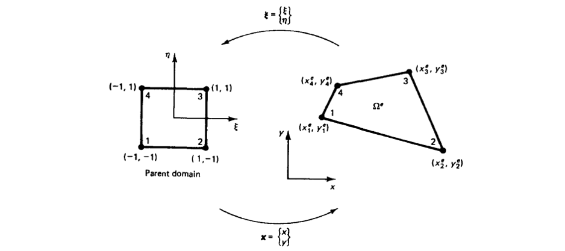
** Change of Coordinates
The coordinates of a point
[[./6.fig3-coordinatemaps.png]]
where $\xi$ and $\eta$ are sometimes called the */natural coordinates/*.
*** Bilinear Expansions
In tensor form this reads
\[ \boldsymbol{x}(\boldsymbol{\xi}) = \sum_{a=1}^4 N_a(\boldsymbol{\xi}) \boldsymbol{x}_a^e \]
The shape functions $N_a$ are obtained by first assuming the "bilinear expansions"

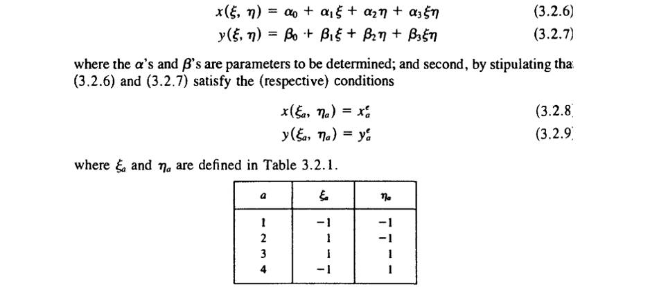
*** Bilinear Mapping Functions
Equations (3.2.6) to (3.2.9) lead to the following matrix equations:

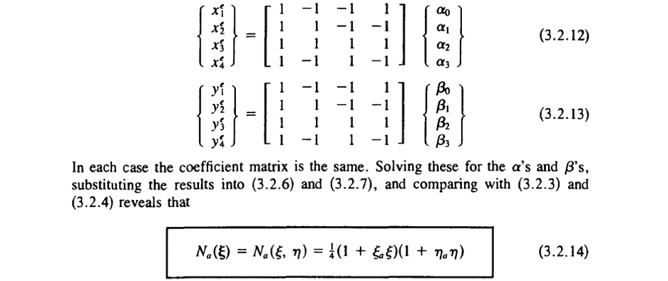
#+REVEAL: split
The bilinear mapping functions are illustrated below.

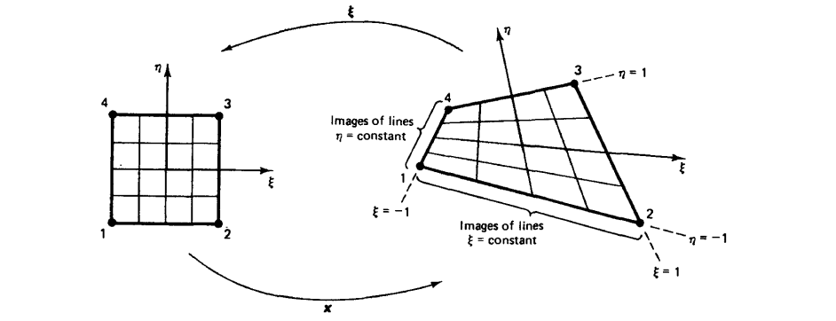
Notice that coordinate lines in $\boldsymbol{\xi}$ space (i.e., lines such that $\xi=$ constant or $\eta=$ constant) are mapped into straight lines in $\boldsymbol{x}$ space.
** Isoparametric Assumption
We shall /assume/ that the element shape functions are given by similar expansions in terms of the mapping functions:

*Heat Conduction*
\[ u^h (\boldsymbol{\xi}) = \sum_{a=1}^4 N_a(\boldsymbol{\xi}) d_a^e \]

*Elastostatics*
\[ u_i^h (\boldsymbol{\xi}) = \sum_{a=1}^4 N_a(\boldsymbol{\xi}) d_{ia}^e \]
*** Properties of Bilinear Mapping Functions
**** R1. Smoothness on $\Omega^e$.
The smoothness condition can be shown to be valid for any quadrilateral for which all internal angles are less then 180$^\circ$.
**** R2. Continuity across $\Gamma^e$.
Satisfied.
**** R3. Completeness.
Satisfied.
* ($\S3.3$) Isoparametric Elements
The isoparametric proposition is generally attributed to Taig [6] and Irons [7]. (References from Ch.3 of textbook)
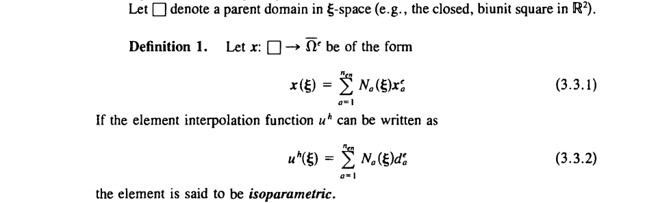
** Convergence Conditions
#+ATTR_REVEAL: :frag (appear)
- *Definition 2.* A mapping $\boldsymbol{x}:\Box\to\bar\Omega^e\cup\mathbb{R}^{n_{sd}}$ is said to be */one-to-one/*, if for each point $\boldsymbol\xi^{(1)}$, $\boldsymbol\xi^{(2)}\in \Box$ such that $\boldsymbol\xi^{(1)}\neq\boldsymbol\xi^{(2)}$, then $\boldsymbol{x}^{(1)}\neq\boldsymbol{x}^{(2)}$
- *Definition 1.* $\boldsymbol{x}:\Box\to\bar\Omega^e$ is said to be */onto/* if $\bar\Omega^e = \boldsymbol{x}(\Box)$. (i.e., each point in $\bar\Omega^e$ is the image of a point in $\Box$ under the mapping).
- *Definition 4.* Let $\boldsymbol{x}:\Box\to\bar\Omega^e$ be a differentiable mapping. The determinant of the derivative, denoted by $j=\det(\partial\boldsymbol{x}/\partial\boldsymbol\xi)$ is called the */Jacobian determinant/*.

  Translation in 2D:
  \[ j = \det \begin{bmatrix} x_{,\xi} & x_{,\eta} \\ y_{,\xi} & y_{,\eta} \end{bmatrix} \]
** Remarks
#+ATTR_REVEAL: :frag (appear)
- It is a consequence of the inverse function theorem that if $\boldsymbol{x}$ is
  - one-to-one;
  - onto;
  - $C^k,\, k\geq 1$; and if
  - $j(\boldsymbol\xi)>0$ for all $\boldsymbol\xi\in\Box$;
  then the inverse mapping $\boldsymbol\xi=\boldsymbol{x}^{-1}:\bar\Omega^e\to\Box$ exists and is $C^k$.
- *Proposition 1.* Let the bilinear mapping defined above satisfy (i) through (iv). Then the smoothness requirement (R1) is satisfied.
- The mappings usually satisfy (i) through (iv).
- In computations the sign of the Jacobian is monitored at special points to ensure condition (iv) is satisfied. If a zero or negative value is encountered, computations are terminated.
* ($\S3.5$) Trilinear Hex Element
#+ATTR_REVEAL: :frag (appear)
- The trilinear hexahedral element is the basic element for three-dimensional analysis. The domain $\Omega^e$ is the image of the biunit cube in $\xi$ space under the trilinear mapping
  \[x(\boldsymbol\xi) = \alpha_0 + \alpha_1\xi + \alpha_2\eta + \alpha_3\zeta + \alpha_4\xi\eta + \alpha_5\eta\zeta + \alpha_6\zeta\xi + alpha_7\xi\eta\zeta \]
- 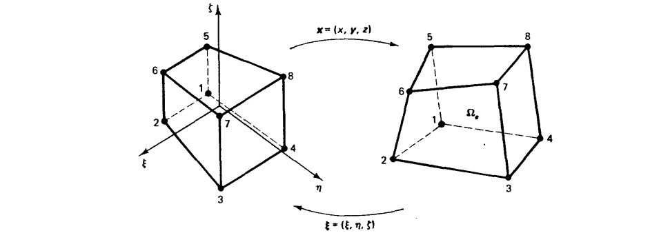
- The coefficients $\alpha_0,\ldots,\alpha_7$ are determined by the conditions
  \[ x(\boldsymbol{\xi_a}) = x_a^e,\hspace{2em} a = 1,\ldots,8 \]
** Trilinear Shape Functions
#+ATTR_REVEAL: :frag (appear)
- Enforcing the above conditions gives rise to a system of linear algebraic equations, viz.,

  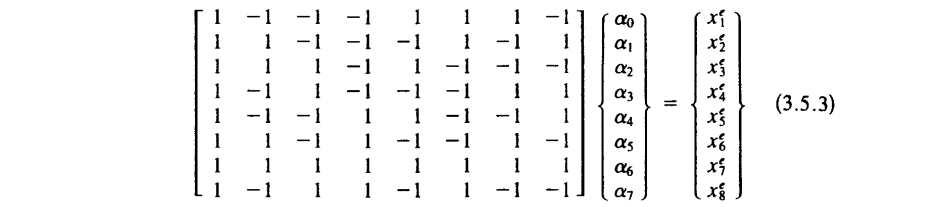
- Solving for $\alpha$'s and substituting into (3.5.3) yields
  \[ x(\boldsymbol\xi) = \sum_{a=1}^8 N_a(\boldsymbol\xi) x_a^e \]
  where
  \[ N_a(\xi,\eta,\zeta) = \frac{1}{8} (1+\xi_a\xi)(1+\eta_a\eta)(1+\zeta_a\zeta) \]
** Isoparametric Shape Functions
#+ATTR_REVEAL: :frag (appear)
- Invoking teh isoparametric concept, i.e.,
  \[ u^h (\boldsymbol\xi) = \sum_{a=1}^8 N_a(\boldsymbol\xi) d_a^e \]
- The hexahedron, or "brick" as it is often referred to, it the most generally useful shape in modeling three-dimensional domains.
- However, it is often convenient to have a wedge-shaped element too, for which the technique of degeneration may be employed.
  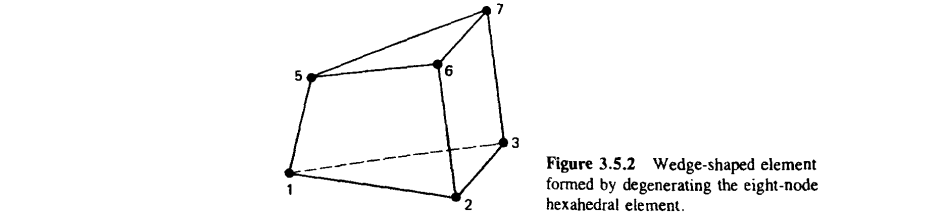
* ($\S3.6$) Higher Order Elements
- Thus far we have considered element for which shape functions are constructed from products of the linear one-dimensional shape functions.
- Systematic derivation of certain higher-order isoparametric elements may be performed with the aid of the one-dimensional Lagrange polynomials.
** Lagrange Polynomials
#+ATTR_REVEAL: :frag (appear)
- The Lagrange polynomials are defined by
  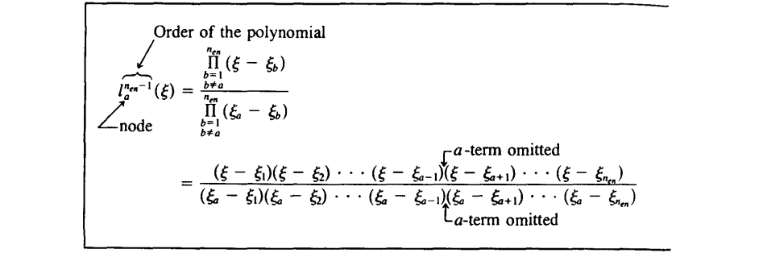
- The general property is
  \[ l_a(\xi_b) = \delta_{ab} \]
- We shall define the shape functions of an $n_{en}$ noded element in *one-dimension* by the relation
  \[ N_a = l_a^{n_{en}-1} \]
*** Three-noded Line Element
As an example the shape functions of a three-noded line element are

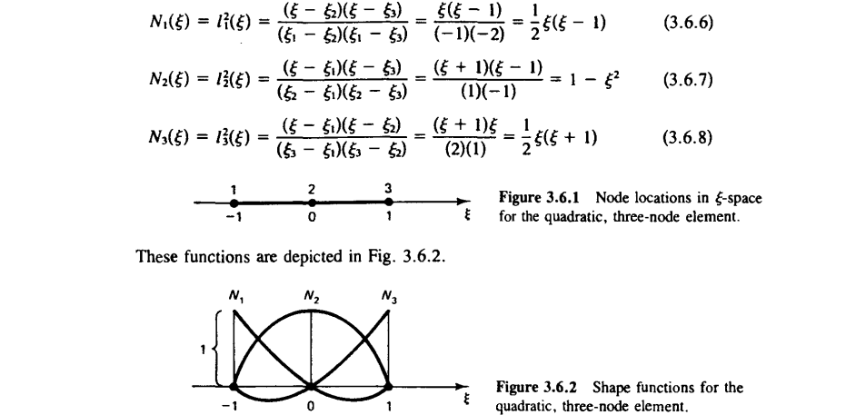
*** Bilinear Quad
The shape functions for the bilinear quadrilateral may be set up by taking products of the first order Lagrange polynomials.
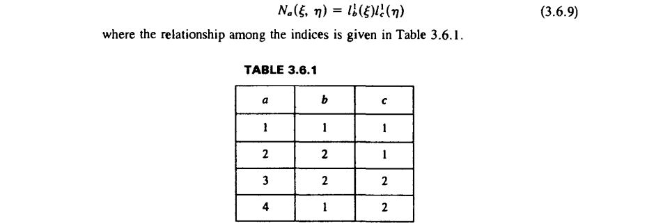
** Higher-order Lagrange Elements
Higher order, two- and three-dimensional elements may be derived by taking products of Lagrange polynomials. This shall be illustrated by setting up the nine-node two-dimensional Lagrange element.

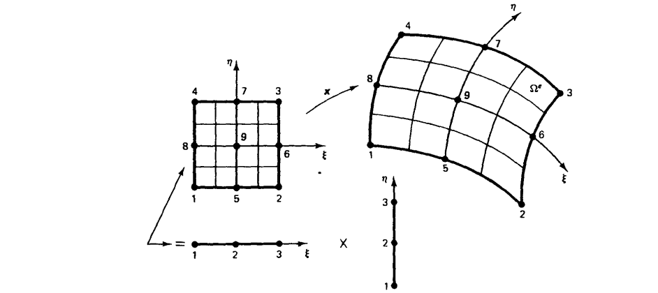
*** Nine-node quadrilateral element (Q9)
The formula for the shape function is
\[ N_a (\xi,\eta) = l_b^2(\xi) l_c^2(\eta) \]
where the relationship among the indices is given in the table below.
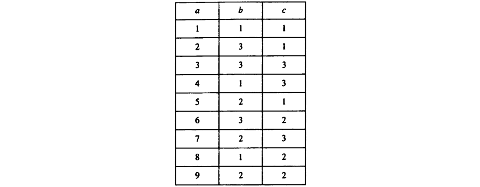

#+REVEAL: split
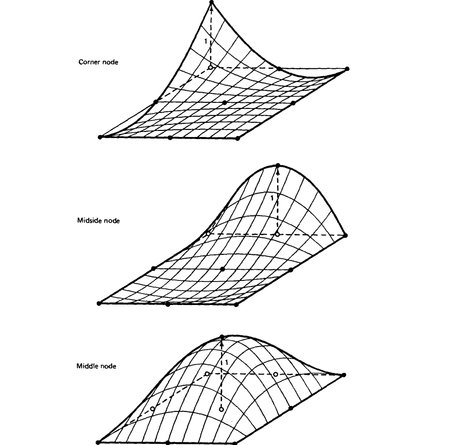
* ($\S3.8$) Gaussian Quadrature
Let $f:\Omega^e \in \mathbb{R}^{n_{sd}} \to \mathbb{R}$ be a given function. We are interested in computing
\[ \int_{\Omega^e} f(\boldsymbol{x}) d\Omega \]
for purposes of constructing element arrays. ($f$ may be thought of as any term in an integrand, such as the integrand in heat conduction $\boldsymbol{B}_a^T \boldsymbol{D} \boldsymbol{B}_a$).
** Pullback to the Parent Domain
#+ATTR_REVEAL: :frag (appear)
- Throughout, we shall assume that $f$ is smooth and integrable.
- We will pull back the integral over the element domain in $\boldsymbol{x}$ space to one over the parent domain (i.e., the biunit $n_{sd}$ cube).
- For $n_{sd} = 1$;
  \[ \int_{\Omega^e} f(x)\, dx = \int_{-1}^1 f(x(\xi)) x_{,\xi}(\xi)\, d\xi \]
- For $n_{sd} = 2$;
  \[ \int_{\Omega^e} f(x,y)\, d\Omega = \int_{-1}^1 \int_{-1}^1 f(x(\xi,\eta),y(\xi,\eta)) j(\xi,\eta)\, d\xi d\eta \]
- Recall that $j=\det(\partial \boldsymbol{x}/\partial \boldsymbol{\xi})$, the Jacobian determinant.
- In each case an integral of the below form has to be evaluated
  
** Numerical (Approximate) Integration
Consider the one-dimensional case, in which we wish to evaluate

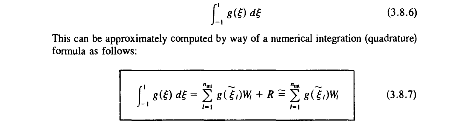
where $n_{int}$ is the number of integration (quadrature) points, $\tilde\xi_l$ is the coordinate of the $l\mathrm{th}$ integration point, $W_l$ is the "weight" of the $l\mathrm{th}$ integration point, and $R$ is the remainder.
*** Trapezoidal Rule
#+ATTR_REVEAL: :frag (appear)
- 
   \begin{align}
   n_\mathrm{int} & = 2\\
   \tilde{\xi}_1 & = -1\\
   \tilde\xi_2 & = 1\\
   W_l & = 1,\hspace{2em} l=1,2\\
   R & = -\frac{2}{3}g_{,\xi\xi}(\tilde\xi)
   \end{align}
- $\tilde\xi$ denotes some point in the interval $[-1,1]$.
- The trapezoidal rule is exact for constants and linear poynomials but only approximate for higher order polynomials.
- It is said to be "second-order accurate".
*** Simpson's Rule
#+ATTR_REVEAL: :frag (appear)
- 
   \begin{align}
   n_\mathrm{int} & = 3\\
   \tilde{\xi}_1 & = -1\\
   \tilde\xi_2 & = 0\\
   \tilde\xi_3 & = -1\\
   W_1 = W_3 & = 1/3\\
   W_2 & = 4/3\\
   R & = \frac{-g^{(4)}(\tilde\xi)}{90}
   \end{align}
- $g^{(4)} = g_{,\xi\xi\xi\xi}$. Simpson's rule integrates general cubic polynomials exactly and is thus said to be "fourth-order accurate"
- Trapezoidal and Simpson's rules are widely used, but there exists integration rules that are just as accurate but involve fewer integration points.
** Gaussian Quadrature Rules
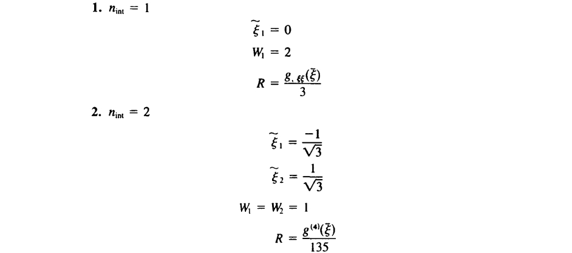

#+REVEAL: split
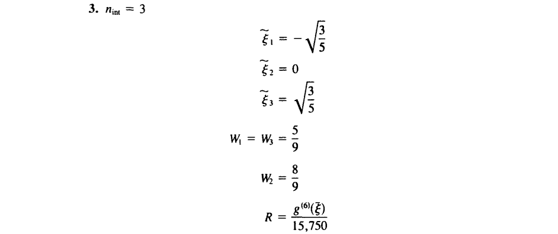
*** Example Derivation for $n_\mathrm{int}=2$
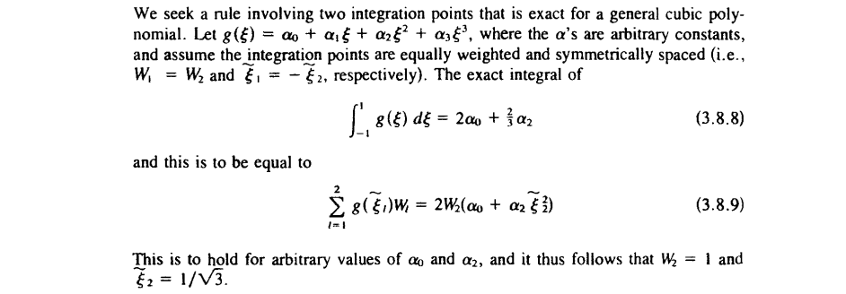
** Gauss Quadrature in Several Dimensions
Gaussian rules for integrals in several dimensions are constructed by employing one-dimensional Gaussian rules on each coordinate separately. For example in two dimensions
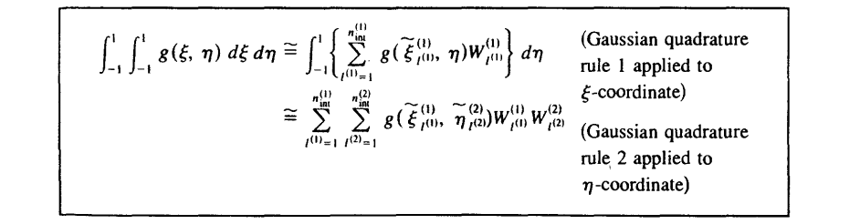

#+REVEAL: split
It is frequently preferable to tabulate multidimensional rules in terms of a single index so that we would have
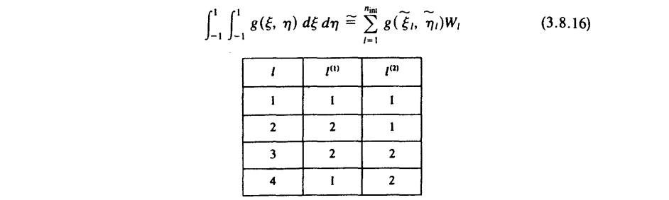
* ($\S3.9$) Shape Function Subroutines
* ($\S3.10$) Stiffness Coding Styles
